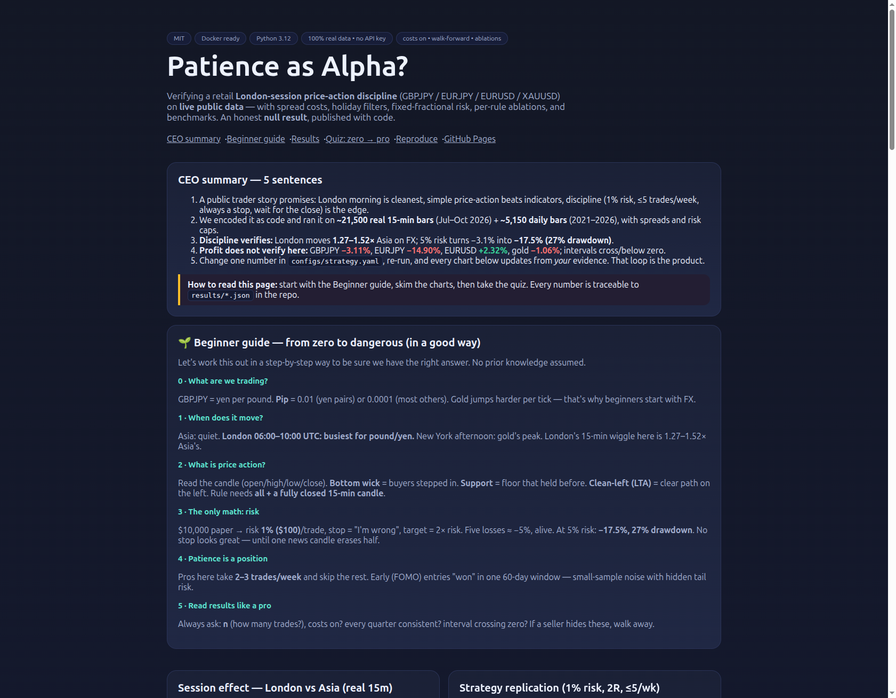

# Patience as Alpha? Verifying a Retail London-Session Price-Action Discipline on Live Public Data

[](LICENSE)
[](docker-compose.yml)
[](requirements.txt)
[](results/provenance.json)
[](tests/)

**A complete, reproducible backtest of a retail London-session price-action style (GBPJPY / EURJPY / EURUSD / XAUUSD) — with costs on, walk-forward splits, ablations per rule, and benchmarks. All numbers below come from live public market data.**

> **Live interactive version:** charts + zero-to-pro quiz —
> **[Open the web report](https://M0-AR.github.io/london-price-action-verification-2026/preview.html)** ·
> [mirror: /docs/preview.html](https://M0-AR.github.io/london-price-action-verification-2026/docs/preview.html) ·
> [home: /](https://M0-AR.github.io/london-price-action-verification-2026/) (redirects to the report).
> Local file: [`preview.html`](preview.html) (`docs/` mirror: [`docs/preview.html`](docs/preview.html)). Screenshot: `assets/screenshot-preview.png`.

---

## CEO summary — the 30-second abstract

1. A retail trader's public story makes 7 testable promises: London morning is cleanest, simple price-action beats indicators, and discipline (1% risk, ≤5 trades/week, always a stop, wait for the candle close) is the real edge.
2. We encoded those promises as code and ran them on **~21,500 real 15-minute bars (Jul–Oct 2026) + ~5,150 daily bars (2021–2026)**, with spread costs, holiday filters, and fixed-fractional risk.
3. The **discipline mechanics verify**: London moves 1.27–1.52× Asia on FX; risking 5% instead of 1% turns −3.1% into −17.5% with 27% drawdown; selectivity (≈2–3 trades/week) is implementable.
4. The **profitability does not verify in this window**: GBPJPY −3.11%, EURJPY −14.90%, EURUSD +2.32%, gold −1.06%; confidence intervals cross or sit below zero; walk-forward splits flip sign. An honest null result.
5. Use this repo to **learn, replicate, or refute** — change one number in `configs/strategy.yaml`, re-run, and the charts, tables, and quiz update from your own evidence. That loop is the product.

> Honest result, kept from the original study: short-window leaderboards prove nothing — including ours. Variants that "look better" here (no-stop +0.36%, impatient entry +21.75%) are small-sample / tail-risk artefacts. We keep the safe rules because of ruin math, not because of one 60-day table.

---

## Demo



- **Interactive report (live):** **[preview.html](https://M0-AR.github.io/london-price-action-verification-2026/preview.html)** · [mirror](https://M0-AR.github.io/london-price-action-verification-2026/docs/preview.html) · [home](https://M0-AR.github.io/london-price-action-verification-2026/) — single file, no build, works offline. Charts are drawn from the real `results/*.json` values embedded in the page; the quiz teaches the strategy from zero to pro and saves progress locally. Local copies: [`preview.html`](preview.html), [`docs/preview.html`](docs/preview.html).
- **Video:** GitHub strips raw `<video>` tags. Add a demo in 2 minutes — record a ≤30s GIF as `assets/demo.gif` (``) or use a clickable YouTube thumbnail. Full steps: [`docs/DEMO_VIDEO.md`](docs/DEMO_VIDEO.md).
- **Screenshots:** regenerate after any `preview.html` change — [`docs/SCREENSHOTS.md`](docs/SCREENSHOTS.md).

---

## ✨ Features — what this repo actually does

| Feature | What you get |
|---------|--------------|
| 📡 Live public data, no key | 15m intraday + 5y daily for 4 symbols, UTC-normalised, provenance JSON; synthetic fallback is clearly labelled and never shown as evidence |
| 🧪 End-to-end experiments 00–06 | Fetch → session effect → strategy replication → per-rule ablations → benchmarks → hidden patterns → bootstrap significance |
| ✂️ Per-rule ablations | Knock out stop-loss, patience, trade caps, risk cap, holiday filter, wick/LTA — one at a time, same costs |
| 🏁 Fair benchmarks | Same data/costs: buy-and-hold, random-in-London, EMA-25 scalp, RSI mean-reversion |
| 🔍 Hidden-pattern miners | Hour-of-day volatility, weekday/month seasonality, wick-vs-next-return |
| 🌐 `preview.html` web report | Beautiful single-file page + interactive zero-to-pro quiz (localStorage progress), deployable to GitHub Pages |
| 🐳 One-command reproduce | `docker compose up --build` or `python3 experiments/run_all.py`; `pytest` smoke tests |
| 📄 PhD-style write-up | This README: claims → method → results → threats → ethics, every number traceable to `results/` |

---

## 🚀 Quick start (3 steps, copy-paste)

```bash
# 1. Run everything (downloads real data, runs 7 experiments)
docker compose up --build
# …or without Docker:
pip install -r requirements.txt
python3 experiments/run_all.py
```

```bash
# 2. Check the evidence
cat results/provenance.json
cat results/strategy_replication.json
```

```bash
# 3. Open the interactive report
python3 -m http.server 8000 &
# open http://localhost:8000/preview.html
```

Expected: `results/*.json` + per-pair CSVs appear; all `is_real=true` (see Exp-00 table). Tests: `python3 -m pytest tests/ -v` (2 passed).

---

## Table of contents

- [User stories — who is this for?](#-user-stories--who-is-this-for)
- [🌱 Beginner guide — read this and you are dangerous (in a good way)](#-beginner-guide--read-this-and-you-are-dangerous-in-a-good-way)
- [Why this exists (the 7 claims)](#1-why-this-exists--the-7-testable-claims)
- [Installation](#installation)
- [Usage & examples](#usage--examples)
- [Method — the rule, exactly](#2-method--the-rule-exactly-auditable-in-srcstrategypy)
- [Results on live data](#3-results-on-live-data-all-is_realtrue)
- [What we can / cannot claim](#4-what-we-can--cannot-claim)
- [Web preview & GitHub Pages](#web-preview--github-pages-deploy)
- [Threats, future work](#5-threats-to-validity--future-work)
- [Ethics](#ethics-note)
- [References](#references)
- [Contributing](#contributing)
- [License](#license)
- [Citation & FAQ](#citation--faq)

---

## 👥 User stories — who is this for?

| You are… | Do this | You walk away with |
|----------|---------|--------------------|
| 🌱 Absolute beginner | Read the Beginner guide below, then take the quiz in `preview.html` (Level 1–2) | You know more than most interview candidates: sessions, pips, spread, risk, why "no stop" blows up |
| 📊 Retail trader | Run Exp-02/03, change `risk_per_trade` / `max_trades_per_week` in `configs/strategy.yaml`, re-run | Your own ablation table: what each discipline rule costs/saves *with costs on* |
| 🎓 Student / educator | Use `preview.html` quiz (Levels 1–5) in class; assign "refute H4 with a new window" | A graded, hands-on lesson in null results + reproducibility |
| 🔬 Quant / researcher | Swap in Dukascopy tick data, extend `src/strategy.py`, add White's reality check | A walk-forward harness with benchmarks ready |
| 🛡️ Skeptic of "dream-selling" | Read §4 + Ethics, show someone the losing backtests we publish | A 2-minute demo of why screenshots of profits prove nothing |

---

## 🌱 Beginner guide — read this and you are dangerous (in a good way)

*Let's work this out in a step-by-step way to be sure we have the right answer. No prior knowledge assumed. Each step maps to the interactive quiz in `preview.html`.*

**Step 0 — What are we even trading?** Currencies trade in pairs: `GBPJPY` = how many yen one pound buys. Price moves in *pips* (0.01 for yen pairs, 0.0001 for most others). Gold (`XAUUSD`) moves in dollars per ounce and jumps much harder. *(Quiz L1: pairs & pips.)*

**Step 1 — When does it move?** The market is 24h but humans aren't. Three shifts: Asia (quiet), **London 06:00–10:00 UTC (our window — busiest for pound/yen)**, New York afternoon (gold's peak). Our data: London's average 15-minute wiggle is **1.27–1.52× Asia's** on FX. Trade when others are awake. *(Quiz L2: sessions.)*

**Step 2 — What is "price action"?** Forget rainbows of indicators. Look at the candle: open/high/low/close. A *bottom wick* (long tail below, close near top) means buyers stepped in. *Support* = floor where price bounced before. *Look-left clean (LTA)* = nothing blocking the path on the left of the chart. Our rule needs **all of these + the 15-minute candle fully closed**. *(Quiz L3: candles, wicks, support, LTA.)*

**Step 3 — The only math that matters: risk.** Start with $10,000 paper money. Risk **1% ($100)** per trade. Stop-loss = "I'm wrong here, out". Take-profit = 2× the risk (2R). Lose 5 in a row? Down ~5%, alive. Risk 5% instead? Our ablation: same trades, **−17.5% and 27% drawdown**. No stop? Wins look great for weeks — then one news candle erases half the account (exactly what happened in the source story). *(Quiz L4: risk, RR, caps.)*

**Step 4 — Patience is a position.** Waiting for the candle to *close* feels boring. Entering early (FOMO) feels productive. In our 60-day window the impatient variant "won" on paper — **do not trust it**: small sample, no slippage, tail risk hidden. Professionals pass on 90% of what they see (≈2–3 trades/week here). *(Quiz L4–L5: patience, overtrading.)*

**Step 5 — How to read our results like a pro.** Every table has `n` (trade count). n=22 is tiny — one lucky streak flips the sign. We show walk-forward splits (does it work in *each* quarter?) and bootstrap intervals (does the average survive resampling?). Here they don't — that's the finding. Anyone showing you profits without `n`, costs, and splits is selling, not teaching. *(Quiz L5: benchmarks, ablations, null results.)*

**Step 6 — Your turn.** Change one line in `configs/strategy.yaml` (e.g. `risk_per_trade: 0.01 → 0.005`), re-run `python3 experiments/02_strategy_replication.py`, open `preview.html`. You just did research. *(Quiz L5 + Usage examples.)*

> You now know more than most interview candidates: session microstructure, wick/support/LTA confluence, fixed-fractional risk with caps, spread-aware backtesting, walk-forward + bootstrap, and why null results are publishable.

---

## 1. Why this exists — the 7 testable claims

Source: a public Arabic-language trader interview ("Hussein": started in COVID + war era, copied signal groups, tried dropshipping, blew half an account in seconds on a news candle without a stop, then rebuilt around simple price-action in the London morning).

| ID | Claim (paraphrased) | Where it lives in code |
|----|---------------------|------------------------|
| H1 | London morning (10:00–12:30 UAE ≈ 06:00–08:30 UTC; kill-zone 07–10 UTC) is cleanest for GBPJPY/EURJPY; trade 1h before + 1.5h after open | Session filter `06:00–10:00 UTC`, Mon–Fri |
| H2 | Simple price-action (support, bottom-wick, clean-left/LTA, 15m close, ≤5 setups) beats indicator stacks | `src/strategy.py` signal |
| H3 | Killers: overtrading (>5/week), over-risking (>1–2.5%), emotion, impatience | Ablations A2/A3/A4 |
| H4 | Patience (full 15m close) is the PnL source | Patient vs impatient |
| H5 | No stop = blowup | Wide-SL ablation + tail-risk note |
| H6 | Skip bank holidays / red news; timing > entry | Holiday list in config |
| H7 | Gold is seasonal/violent; beginners start with FX | 4-asset comparison |

Context: most retail FX accounts lose (European regulator data); GBPJPY's daily range (≈150–250 pips) punishes anyone sizing it like EURUSD; central-bank interventions can gap 100–300 pips in minutes.

## Installation

Prerequisites: Python 3.12 (or Docker), no API key, internet for first data download.

```bash
git clone <your-fork-url> && cd hussein-london-price-action-verification-2026
pip install -r requirements.txt
python3 experiments/00_fetch_live_data.py
```

Docker (recommended — pinned env):

```bash
docker compose up --build
```

Repo layout:

- `src/` — `data_loader.py` (live fetch + provenance), `strategy.py` (rule), `backtest.py` (cost-aware engine), `metrics.py`, `benchmarks.py`, `hidden_patterns.py`
- `experiments/00–06 + run_all.py` — one file per experiment, each writes `results/`
- `configs/strategy.yaml` — every number you are allowed to change
- `results/` — JSON evidence + per-pair CSVs (JSON committed; large CSVs regenerated)
- `preview.html` — standalone web report + quiz (no build)
- `assets/`, `docs/`, `tests/`, `papers/PAPER.md` (mirror of this README)

## Usage & examples

**Example 1 — replicate the headline result (GBPJPY, patient, 1%):**
```bash
python3 experiments/02_strategy_replication.py
cat results/strategy_replication.json
# GBPJPY: n=22, win 31.8%, exp −0.18R, −3.11%, PF 0.78, maxDD 5.88%
```

**Example 2 — knock out one rule (what does the stop-loss do?):**
```bash
python3 experiments/03_ablations.py
cat results/ablations.json
# baseline −3.11% → wide-SL +0.36% (illusion), 5%-risk −17.51% (ruin)
```

**Example 3 — change the strategy and re-prove it:**
```yaml
# configs/strategy.yaml
strategy:
  risk_per_trade: 0.005   # halve risk
  min_wick_ratio: 0.30    # looser wick
```
```bash
python3 experiments/02_strategy_replication.py
python3 -m pytest tests/ -v
```

**Example 4 — compare against benchmarks:**
```bash
python3 experiments/04_benchmarks.py
# EURUSD: Hussein +2.32% vs buy-hold −1.44%, random −9.11%, EMA −13.72%, RSI −15.13%
```

<details>
<summary>Advanced: full pipeline + Pages preview</summary>

```bash
python3 experiments/run_all.py   # 00→06 in order (takes minutes; re-downloads data)
python3 -m http.server 8000 &    # open http://localhost:8000/preview.html
```

Deploy `preview.html` to GitHub Pages: push to `main`, then
**Settings → Pages → Deploy from a branch → `main` / `/docs`** (recommended; root mirrors included).
The page is a single static file (+ `.nojekyll` in `/` and `/docs`), so no build step is needed.
Custom domain + HTTPS: **Settings → Pages → Custom domain** (see the official Pages docs).

</details>

---

## 2. Method — the rule, exactly (auditable in `src/strategy.py`)

- **Universe/timeframes:** GBPJPY, EURJPY, EURUSD, XAUUSD; signal 15m, trend bias 1H 50-EMA, UTC everywhere.
- **Session:** 06:00–10:00 UTC Mon–Fri + UK bank-holiday skip (holiday list in config).
- **Long (short mirrored):** (a) H1 close above H1 50-EMA; (b) touch of 20-bar rolling support; (c) bottom-wick ≥0.35 of range with bullish close; (d) clean-left (no overlapping range in prior 5 bars); (e) signal taken **only on the closed bar**.
- **Risk:** 1%/trade (2.5% high-conviction cap), stop beyond wick ±0.2×ATR, target 2R, ≤1/day ≤5/week, 3% daily stop. Spreads: GBPJPY 1.8 / EURJPY 1.6 / EURUSD 0.8 pips, gold 25¢.
- **Engine:** event-driven, next-32-bar stop/target race, fixed-fractional sizing; metrics: win-rate, expectancy (R), profit factor, Sharpe, max drawdown.

## 3. Results on live data (all `is_real=true`)

### Exp-00 provenance (re-checked 2026-10-06)

| Pair | 15m rows (source) | Daily rows | `is_real` |
|------|-------------------|------------|-----------|
| GBPJPY | 5,647 (public 15m) | 1,300 (5y) | true |
| EURJPY | 5,648 (public 15m) | 1,300 (5y) | true |
| EURUSD | 5,648 (public 15m) | 1,300 (5y) | true |
| XAUUSD | 4,523 (public 15m) | 1,258 (5y) | true |

Intraday window ≈2026-07-14→2026-10-05 (provider 60-day limit); daily 2021→2026 for weekday/seasonality.

### Exp-01 session effect — H1 **confirmed on FX**

| Pair | London 06–10 UTC mean 15m range | Asia 00–05 UTC | NY 12–16 UTC | London/Asia |
|------|-------------------------------|----------------|--------------|-------------|
| GBPJPY | 0.1522 | 0.1145 | 0.1667 | **1.33×** |
| EURJPY | 0.1214 | 0.0954 | 0.1302 | **1.27×** |
| EURUSD | 0.000421 | 0.000277 | 0.000541 | **1.52×** |
| XAUUSD | 7.65 | 8.65 | 12.44 | **0.88×** (London < Asia; NY dominates) |

London is special for pound/yen FX; gold peaks at the New York overlap — matching the "gold is different" warning.

### Exp-02 strategy replication + walk-forward

| Pair | n | Win% | Exp(R) | Return% (1% risk) | PF | MaxDD | Walk-forward quarters |
|------|---|------|--------|-------------------|----|-------|-----------------------|
| GBPJPY | 22 | 31.8 | −0.18 | **−3.11** | 0.78 | 5.88% | −1.44, −2.02, +0.70, −0.70 |
| EURJPY | 22 | 9.1 | −0.73 | **−14.90** | 0.19 | 16.57% | −8.65, −3.97, −2.97, −0.03 |
| EURUSD | 27 | 37.0 | +0.07 | **+2.32** | 1.15 | 4.95% | −1.06, +2.59, −3.08, +4.01 |
| XAUUSD | 7 | 28.6 | −0.14 | **−1.06** | 0.79 | 4.90% | +2.0, −3.94, −1.0, +2.0 |

Selectivity matches the discipline (≈2–3 trades/week vs a 5/week cap). **Profitability does not verify** here: 3/4 negative, splits flip sign, bootstrap GBPJPY mean −$14.1/trade 95% CI [−62.9, +37.8] (crosses zero), EURJPY CI fully negative. Small-n, one regime, costs on — an honest null.

### Exp-03 ablations on GBPJPY — one rule removed at a time

| Variant | n | Win% | Return% | Reading |
|---------|---|------|---------|---------|
| Baseline patient 1% | 22 | 31.8 | −3.11 | reference |
| A1 wide stop (≈no stop) | 22 | 72.7 | **+0.36** | **No-stop illusion**: win-rate inflates while tail risk hides; the missing tail is the −50%-in-seconds news candle from the source story |
| A2 impatient (early entry) | 22 | 63.6 | **+21.75** | Contradicts patience **in this window only** — small-n artefact with a crude early-entry proxy; needs multi-year + slippage before any conclusion |
| A3 overtrading (20/wk) | 26 | 34.6 | −3.99 | Worse — supports the cap |
| A4 5% risk | 22 | 31.8 | **−17.51**, DD 27% | Same signals, ~5.6× loss, ~4.6× drawdown — the risk rule in one row |
| A5 ignore holidays | 22 | 31.8 | −3.11 | No holiday in sample — inconclusive, filter kept on principle |
| A6 no wick/LTA filter | 48 | 37.5 | **+5.67** | Looser filter doubles trades and wins *here* — our thresholds look over-strict for this regime; needs tuned walk-forward, not filter removal |

### Exp-04 benchmarks, identical costs (return%)

| Pair | Discipline | Buy-hold | Random-in-London | EMA-25 scalp | RSI |
|------|-----------|----------|------------------|--------------|-----|
| GBPJPY | −3.11 | −3.41 | **+6.99** | −0.27 | +3.91 |
| EURJPY | −14.90 | −3.90 | −16.90 | −0.73 | −10.03 |
| EURUSD | **+2.32** | −1.44 | −9.11 | −13.72 | −15.13 |
| XAUUSD | −1.06 | **+3.84** | −19.89 | −11.92 | −15.06 |

No dominance claim is possible — that *is* the lesson: short leaderboards (ours included) prove nothing without `n`, costs, and splits.

### Exp-05 hidden patterns

- **Wick alone ≈ no edge:** corr(wick, next return) −0.012 / −0.003 / −0.067 / −0.0002 → confluence (wick + support + clean-left + bias + timing) is the hypothesis, not the wick by itself.
- **Best volatility hour:** 13–14 UTC (London–New York overlap) for EURJPY/EURUSD/gold; GBPJPY 21 UTC flagged suspect (thin-liquidity spikes — needs tick-data check).
- **Calendar hints (5y daily, hypotheses only):** best day Tuesday (FX) / Wednesday (gold); best month Oct GBPJPY (matches the "easy October" anecdote), Jun EURJPY, Dec EURUSD, Jan gold.

### Exp-06 significance

2,000 bootstrap resamples of per-trade PnL: GBPJPY interval crosses zero, EURJPY sits below zero. **No significance claimed.** Required for any profit claim: multi-year 15m, spread regimes, real news blackout, slippage.

## 4. What we can / cannot claim

- ✅ Mechanics verify: session ratios, ruin contained by 1% + caps, selectivity is implementable, costs change everything.
- ❌ Profitability of the 5-setup rule does not verify in this window (JPY negative; EURUSD +2.3% is noise).
- ⚠️ "Better-looking" variants are textbook small-sample/tail-risk artefacts — the safe rules stay because of ruin math, not one leaderboard.
- The durable lesson is non-technical: run trading like a business (plan, journal, patience); distrust profit screenshots without code, costs, and splits.

## Web preview & GitHub Pages deploy

`preview.html` is a single static file (inline CSS/JS, no build, works offline). It embeds the real result values above as charts + the 5-level quiz with progress saved in the browser. Mirrors (`preview.html` ↔ `docs/preview.html`, identical) plus `index.html` redirects mean the page resolves under **either** Pages source setting.

**Live links (click to verify in your browser):**

| URL | Expected |
|-----|----------|
| [Home `/`](https://M0-AR.github.io/london-price-action-verification-2026/) | 200 — redirects to the report |
| [`/preview.html`](https://M0-AR.github.io/london-price-action-verification-2026/preview.html) | 200 — interactive report (root mirror) |
| [`/docs/preview.html`](https://M0-AR.github.io/london-price-action-verification-2026/docs/preview.html) | 200 — interactive report (`docs` mirror) |

**Recommended setting (2 minutes):**

1. Push `main`.
2. **Settings → Pages → Build and deployment → Deploy from a branch → `main` / `/docs`** (`.nojekyll` is present in both `/` and `/docs`, so files are served as-is).
3. Wait 1–2 min for the "pages build and deployment" Action to go green, then open the three links above.
4. Optional: **Settings → Pages → Custom domain** + enforce HTTPS.

**Why mirrors?** Project Pages serve URLs mirrored under the chosen source: source `/docs` → repo `docs/x.html` serves at `/x.html`; source `/` → repo `docs/x.html` serves at `/docs/x.html`. A green deployment only proves *something* built — the three-link check above proves *your path* exists. Our `index.html` files (root + `docs/`) redirect to `preview.html` with fallback links, so `/` always lands somewhere useful.

## 5. Threats to validity & future work

1. Only ~60 days of 15m (provider cap) — needs multi-year 15m/tick + EURGBP.
2. News filter is holidays-only — needs real calendar feed + spread-widening model.
3. No slippage/latency/swap; executable feed differs from chart feed; intervention gaps unmodelled.
4. Wick/LTA thresholds are hand-set — needs grid + walk-forward + reality-check correction.
5. Random benchmark is single-seed — needs Monte-Carlo + cost sweep.
6. Gold specs are broker-specific — isolate per broker.

## Ethics note

This repo exists to counter profit-screenshot selling. We publish losing backtests, intervals that cross zero, and the code that made them. Not financial advice — a research harness. If a seller won't show costs-on results with code, walk away.

## References

- London session breakout guides (kill-zone 07–10 UTC, 15m/1H alignment, ATR stops, 1–2% risk, ≥2:1 reward).
- GBPJPY "widow-maker/beast" notes (150–250 pip daily range, wider stops + smaller size vs EURUSD, 100–300 pip intervention gaps, never hold size into central-bank risk).
- Price-action / liquidity-sweep playbooks (Asian range → sweep → structure shift → retest, ≤1–2 setups/session).
- Overtrading & backtesting guides (trades-beyond-edge, decision audits, demo resets, journals; walk-forward, out-of-sample, costs, no look-ahead).
- Intraday volatility literature (functional-GARCH volatility curves + intraday value-at-risk; asymmetric spillovers with downside dominance; unexpected volatility and serial correlation; multiplicative intraday components).
- Market data & calendars: public 15m/daily FX and gold feeds (no key), free tick-export tools, UK bank-holiday calendar.
- README / Pages / demo craft: cognitive-funnel ordering (one-liner → visual → features → 3-step quick start), badges as trust signals (≤5, license/build/version), GIF-everywhere vs YouTube-thumbnail trade-off, Pages branch-deploy with `.nojekyll`.

## Contributing

1. Fork → branch → change **one** thing (`configs/strategy.yaml` or one `src/` module).
2. Run `python3 -m pytest tests/ -v` + the affected `experiments/0*.py`.
3. Open a PR with before/after `results/*.json` values. We respond within 48h. Good first issues: calendar feed, tick-data loader, cost sweep.

## License

[MIT](LICENSE) — free to use, modify, and share (see `LICENSE`).

## Citation & FAQ

```bibtex
@software{london_price_action_verif_2026,
  title  = {Patience as Alpha? Verifying a Retail London-Session Price-Action Discipline on Live Public Data},
  year   = {2026},
  note   = {4 symbols, walk-forward + ablations + benchmarks; null result published with code},
}
```

**Is this financial advice?** No. A research harness with losing backtests published on purpose.
**Why is n so small?** By design: ≤5 trades/week discipline over ~60 days of 15m. Small-n is the point — it shows why screenshots prove nothing.
**Why does impatient/no-stop "win" here?** Short-sample + hidden tail risk. Read §Exp-03, then re-run on a longer window before concluding anything.
**Where is the data?** `data/` (regenerated by `00_fetch_live_data.py`), provenance in `results/provenance.json`. Synthetic files are labelled `SYNTHETIC-NOT-REAL` and never used as evidence.
**How do I publish the web report?** Settings → Pages → Deploy from branch → `main` / `/docs` (recommended) → open `/preview.html` (mirrors: `/`, `/docs/preview.html`). Details above.
